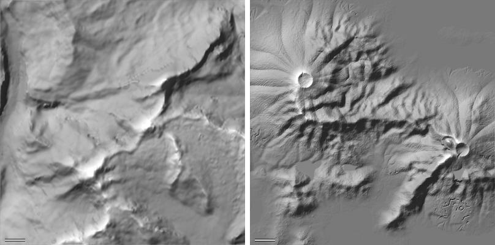
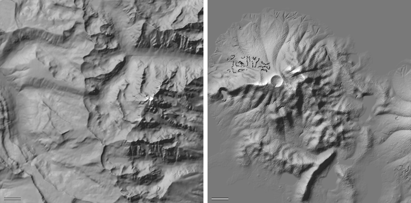
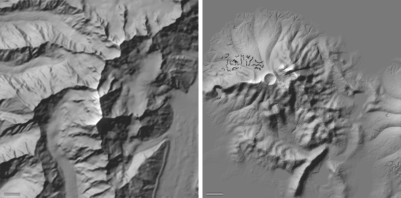
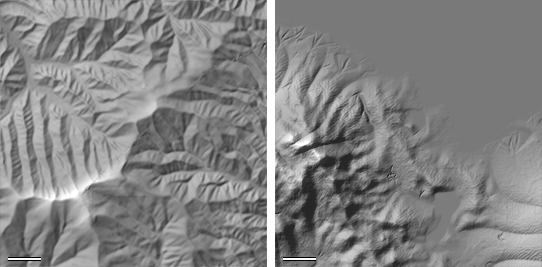
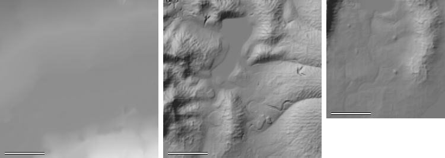
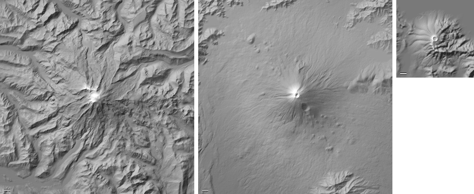

# Real terrain vs the microvoxel mountain generator

How the streamed world's mountains (`prototypes/labs/microvoxel-world/voxel-world-model.js` + `macro-map.js`,
revision `micro-wilds-29`, seed 2718) compare with real terrain of the same kinds, measured with the same code at
the same 30 m resolution. Scripts live in `tools/terrain-study/` (Node, no dependencies); raw tiles and grids go to
`$TMPDIR/terrain-study/` and are never committed.

## Data and method

**Real elevation.** AWS Terrain Tiles (Terrarium PNG, `s3.amazonaws.com/elevation-tiles-prod/terrarium/{z}/{x}/{y}.png`,
height = R·256 + G + B/256 − 32768 m), zoom 12 (native pixel 26–31 m; SRTM/NED/national DEMs underneath). Tiles are
decoded by a 40-line zlib PNG decoder (`png.cjs`), mosaicked and bilinearly resampled onto a local metric grid (30 m,
equirectangular about the area centre).

| area | kind | centre | window |
|---|---|---|---|
| Mt Rainier | stratovolcano | 46.853 N, 121.760 W | 30 km |
| Mt Fuji | stratovolcano | 35.361 N, 138.727 E | 30 km |
| Bernese Alps (Eiger–Jungfrau, Lauterbrunnen) | glaciated alpine | 46.56 N, 7.98 E | 20 km |
| Teton Range | young fault block | 43.74 N, 110.84 W | 20 km |
| Southern Alps NZ (Aoraki) | young, fast uplift | 43.595 S, 170.142 E | 20 km |
| Great Smoky Mountains | old, rounded, fluvial | 35.58 N, 83.48 W | 20 km |
| Gallatin Valley, Montana | intermontane plain | 45.75 N, 111.2 W | 20 km |

**Generator.** `world.geography()` sampled on the same 30 m grid, each pixel the mean of 3×3 sub-samples (a DEM pixel
is an area average; point samples alias the sub-30 m gullies and 4 m cliff bands), water read as its surface (as a DEM
does). Areas were picked from the macro map's range and volcano lists (`scan-ours.cjs`):

| area | what | centre (world m) | window |
|---|---|---|---|
| ours-volcano | volcano H 1623 m on the east spine's end | 7505, −4771 | 16 km |
| ours-volcano2 | coastal volcano H 1543 m | −2523, −7417 | 16 km |
| ours-spine-e | east spine (H 748) + interior chain + branches | 10800, −2700 | 12 km |
| ours-spine-w | west spine (H 809) + coastal range + branches | −600, −6200 | 12 km |
| ours-minor | minor/secondary ranges (H 140–280) | 1800, −8300 | 8 km |
| ours-plain | flattest 4 km land window between ranges | 3100, −5000 | 4 km |
| ours-home | home lowland | 800, 200 | 3 km |

Generated range areas leave out the sea and the ground a volcano dominates (cone height above range relief, the
generator's own `onCone` test), so range statistics describe ranges. "Mountain cells" = ≥ 300 m of relief within ±1 km,
used where a small range sits in lowland so the lowland does not dilute the statistics.

**Metrics** (`metrics.cjs`, identical for both):
- hypsometry: hypsometric integral HI = (mean − min)/(max − min) and skew (all land, and mountain cells only);
- slope (Horn, 30 m): mean and share < 10°, 10–25°, 25–40°, > 40°;
- relief per km: max − min in 1 km blocks (median);
- ridge spacing: median distance between successive ridge crossings (local maxima with ≥ 40 m drop on both sides)
  along every 500 m row/column; also an autocorrelation wavelength of the 3 km high-passed transects;
- spectral slope β of 1D transect power spectra between 120 m and 3 km (P ∝ k^−β);
- drainage: priority-flood fill, D8 flow, channels at ≥ 0.25 km²; drainage density, bifurcation ratio, Strahler order,
  Hack exponent, largest catchment, and the share of land in closed depressions (> 0.5 m deep);
- peaks: topographic prominence by union-find; peaks with ≥ 100 m prominence per 100 km² and their spacing;
- curvature: Laplacian over a 60 m stencil; ridge sharpness = mean −∇²h on divides (single-cell catchments, slope >
  10°), valley sharpness = mean +∇²h on channels (1/km); their ratio (> 1: knife ridges over broad floors, < 1: rounded
  ridges over V valleys);
- volcano: median height per 250 m ring about the summit, base radius (where the median is within 5 % of the base),
  R/H, concavity p in h = H(1 − r/R)^p, flank slope at 20/40/60/80 % of R, and ribs on circles at 0.3/0.5/0.7 R
  (angular residual after removing harmonics 0–3: rib count and peak-to-trough depth).

## Scale first

Our world is a miniature: the whole continent is ~263 km² of land (32 × 20 km macro map), the tallest range crest
is ~800 m above its foot with a 1.5–2 km half-width, and the volcanoes stand ~1.45 km with 4–5 km base radius. The real
ranges here have 2–3 km of relief over 20–50 km widths, Rainier and Fuji ~3 km over ~11 km+ radii. Because hillslopes
are threshold-limited in both, **slope and relief per km match well**, so the generator is effectively building
real-looking slopes on 1/3-scale ranges. Window-dependent numbers (largest catchment, maximum Strahler order) differ
mostly for that reason and are not ranked below.

## Comparison


*Bernese Alps (left, 12 km of the Eiger–Lauterbrunnen window) vs east spine (right, 12 km). 30 m/px; bar = 1 km.*


*Tetons (left) vs west spine (right). 30 m/px.*  *Southern Alps NZ vs west spine.*


*Great Smoky Mountains (left, 8 km) vs our minor/secondary ranges (right, 8 km; the flat area is sea).*


*Gallatin Valley (left, 4 km), our flattest 4 km between ranges (middle), home lowland (right, 3 km). 15 m/px.*


*Rainier (30 km), Fuji (30 km), our volcano (16 km), all at 75 m/px: ours is a ~1/2-scale cone.*

## Numbers

Full output in [metrics.json](metrics.json). Bold rows are the generator. "mtn" = mountain cells (≥ 300 m relief within
±1 km). Drainage channels start at 0.25 km²; sharpness is the 60 m Laplacian on divides / channels.

### Slopes, relief, hypsometry

| area | land | relief p50 m/km | slope mean ° | <10° % | 10–25° % | 25–40° % | >40° % | mountain-cell slope ° | mtn >40° % | HI (land) | HI (mtn) | skew |
|---|---|---|---|---|---|---|---|---|---|---|---|---|
| rainier | 1.00 | 447 | 24.1 | 15 | 37 | 38 | 10 | 24.4 | 10 | 0.27 | 0.28 | 1.34 |
| fuji | 1.00 | 133 | 9.7 | 67 | 25 | 8 | 0 | 15.2 | 0 | 0.26 | 0.31 | 1.44 |
| bernese | 1.00 | 574 | 27.3 | 13 | 33 | 33 | 21 | 27.4 | 21 | 0.50 | 0.51 | -0.13 |
| tetons | 1.00 | 423 | 22.5 | 25 | 31 | 31 | 13 | 25.1 | 15 | 0.32 | 0.34 | -0.10 |
| southern-alps | 1.00 | 633 | 29.4 | 16 | 20 | 35 | 28 | 29.7 | 28 | 0.39 | 0.40 | 0.35 |
| smokies | 1.00 | 343 | 24.7 | 5 | 42 | 51 | 2 | 24.8 | 2 | 0.47 | 0.47 | 0.07 |
| gallatin | 1.00 | 12 | 1.2 | 99 | 1 | 0 | 0 | – | – | 0.32 | – | 0.53 |
| **ours-volcano** | 0.67 | 468 | 21.6 | 30 | 31 | 24 | 15 | 25.1 | 19 | 0.21 | 0.25 | 1.30 |
| **ours-volcano2** | 0.47 | 459 | 20.8 | 31 | 34 | 20 | 14 | 24.2 | 18 | 0.17 | 0.21 | 1.73 |
| **ours-spine-e** | 0.34 | 428 | 22.9 | 33 | 23 | 23 | 21 | 25.4 | 24 | 0.18 | 0.21 | 1.28 |
| **ours-spine-w** | 0.37 | 462 | 20.6 | 35 | 28 | 21 | 16 | 24.6 | 21 | 0.13 | 0.16 | 2.01 |
| **ours-minor** | 0.28 | 478 | 22.9 | 24 | 35 | 24 | 17 | 26.6 | 23 | 0.18 | 0.23 | 1.62 |
| **ours-plain** | 1.00 | 247 | 17.7 | 25 | 52 | 18 | 4 | 19.2 | 6 | 0.22 | 0.23 | 1.15 |
| **ours-home** | 0.97 | 98 | 7.7 | 75 | 21 | 3 | 2 | 10.5 | 7 | 0.10 | 0.11 | 2.98 |

### Texture, drainage, peaks, curvature

| area | ridge gap km | autocorr λ km | spectral β | drainage density km/km² | bifurcation Rb | Hack h | closed depressions % | peaks ≥100 m prom. /100 km² | peak spacing km | ridge sharpness 1/km | valley sharpness 1/km | ridge/valley |
|---|---|---|---|---|---|---|---|---|---|---|---|---|
| rainier | 1.77 | 2.64 | 3.29 | 1.38 | 5.94 | 0.52 | 0.4 | 6.7 | 2.06 | 8.83 | 5.88 | 1.50 |
| fuji | 2.37 | 2.58 | 3.07 | 2.05 | 4.83 | 0.50 | 2.8 | 1.2 | 6.33 | 4.53 | 1.87 | 2.43 |
| bernese | 2.70 | 2.76 | 4.08 | 1.31 | 3.98 | 0.44 | 0.8 | 4.7 | 2.97 | 5.92 | 2.19 | 2.71 |
| tetons | 1.50 | 2.64 | 3.13 | 1.28 | 4.58 | 0.47 | 1.7 | 8.7 | 1.50 | 11.03 | 4.35 | 2.54 |
| southern-alps | 1.71 | 2.82 | 3.71 | 1.35 | 4.88 | 0.50 | 1.0 | 6.7 | 2.48 | 11.69 | 4.67 | 2.50 |
| smokies | 1.11 | 2.52 | 3.10 | 1.26 | 4.58 | 0.52 | 0.0 | 4.2 | 3.21 | 9.08 | 10.56 | 0.86 |
| gallatin | 2.76 | 2.64 | 2.62 | 1.92 | 4.54 | 0.46 | 0.2 | 0.0 | – | 3.29 | 0.43 | 7.61 |
| **ours-volcano** | 1.11 | 2.34 | 3.45 | 1.15 | 4.45 | 0.44 | 2.1 | 7.6 | 1.55 | 6.24 | 7.80 | 0.80 |
| **ours-volcano2** | 1.11 | 2.34 | 2.97 | 1.14 | 5.20 | 0.52 | 2.7 | 7.5 | 1.45 | 6.88 | 9.16 | 0.75 |
| **ours-spine-e** | 1.17 | 2.40 | 3.67 | 0.69 | 6.69 | 0.29 | 0.6 | 14.2 | 2.41 | 7.23 | 5.98 | 1.21 |
| **ours-spine-w** | 1.35 | 2.34 | 3.71 | 0.78 | 5.39 | 0.65 | 1.5 | 17.1 | 2.03 | 6.85 | 4.81 | 1.43 |
| **ours-minor** | 1.11 | 2.16 | 3.86 | 0.72 | 4.50 | 0.80 | 2.0 | 17.0 | 1.48 | 7.00 | 6.27 | 1.12 |
| **ours-plain** | 1.05 | 1.92 | 3.82 | 1.04 | 4.17 | 0.43 | 10.6 | 18.8 | 1.80 | 4.72 | 5.58 | 0.85 |
| **ours-home** | – | – | – | 0.91 | 6.00 | 0.76 | 2.4 | 0.0 | – | 3.10 | 3.03 | 1.02 |

### Volcanoes

| volcano | H above base m | base radius m | R/H | concavity p | flank slope at 20/40/60/80 % R (°) | ribs at 0.3 / 0.5 / 0.7 R (count, depth m) |
|---|---|---|---|---|---|---|
| rainier | 3064 | 11375 | 3.71 | 1.67 | 25.6 / 18.9 / 9.6 / 8.2 | 16, 267 / 17, 435 / 18, 536 |
| fuji | 2867 | 11125 | 3.88 | 1.47 | 21.8 / 15.6 / 9.0 / 6.1 | 12, 133 / 16, 132 / 10, 154 |
| **ours-volcano** | 1448 | 4375 | 3.02 | 1.25 | 25.9 / 24.6 / 20.8 / 10.5 | 13, 139 / 14, 233 / 13, 319 |
| **ours-volcano2** | 1450 | 4125 | 2.85 | 1.20 | 16.7 / 27.0 / 22.8 / 11.8 | 13, 241 / 15, 392 / 15, 321 |

### What already matches

- **Hillslope steepness.** Mountain-cell mean slope 24–27° (ours) vs 24–30° (Rainier, Bernese, Tetons, NZ, Smokies);
  relief per km 428–478 m vs 343–633 m. Slopes are threshold-limited in both; this is the generator's strongest point.
- **Roughness spectrum.** β 3.0–3.9 vs 3.1–4.1 (Gallatin 2.6): the crag + erosion octave mix has a realistic falloff.
- **Network topology.** Bifurcation ratio 4.2–6.7 vs 4.0–5.9; Hack exponent 0.29–0.80 vs 0.44–0.52 (small windows, noisy).
- **Volcano ribs.** 13–15 ribs per circle vs 16–18 (Rainier) and 10–16 (Fuji); depth 0.1–0.27 H vs 0.09–0.17 H
  (Rainier, glacial) and ~0.05 H (Fuji). A little deep, but the count and the downslope deepening are right.
- **Ridge and peak spacing scale with the ranges.** Ridge gap 1.1–1.35 km (Smokies 1.1, Tetons 1.5, Bernese 2.7); peaks
  ≥ 100 m prominence are 2–3× denser than real (14–19 vs 4–9 per 100 km²), which is what 1/2–1/3-scale ranges give.
  Three patches aimed at peak density did not move it (below), so it is not ranked.


## Ranked discrepancies and proposed changes

Measured experiments were run with `experiment.cjs` (patches applied in memory to the generator source; the
generator itself is unchanged in this commit). "Untested" means proposed from the numbers but not measured.

| patch | area | metric: baseline → patched | real target | verdict |
|---|---|---|---|---|
| `cone` | ours-volcano | R/H 3.02 → 3.63; flank slope 40 % R 24.6 → 14.3°, 60 % R 20.8 → 11.7°, 80 % R 10.5 → 8.8°; p 1.25 → 1.29; pits 2.1 → 1.5 % | R/H 3.7–3.9; 15.6–18.9° / 9.0–9.6° / 6.1–8.2°; p 1.5–1.7 | **works** |
| `rangepw` | spine-e / spine-w | mtn HI 0.21 → 0.22 / 0.16 → 0.19; slope >40° 21 → 22 / 16 → 13 % | HI 0.34–0.50 | marginal |
| `apronhills` | ours-plain / home | slope 17.7 → 17.4° / 7.7 → 7.6°; <10° 25 → 26 % | Gallatin 1.2°, 99 % | **no effect** |
| `bigridge` | spine-e | peaks/100 km² 14.2 → 14.2; ridge gap 1.17 → 1.11 km | 4–9 | no effect |
| `bigamp` | spine-e / spine-w | peaks 14.2 → 12.2 / 17.1 → 17.1; >40° 21 → 19 / 16 → 15 % | 4–9 | small |
| `crestnoise` | spine-e / spine-w | peaks 14.2 → 16.2 / 17.1 → 18.9 | 4–9 | worse |

### Ranked list

1. **Volcano cones are too narrow and straight-sided** (measured fix). Ours: R/H 2.9–3.0, flanks still 21–23° at 60 % of
   the radius; Rainier/Fuji: R/H 3.7–3.9, 9° at 60 %, long concave aprons (p 1.5–1.7 vs our 1.2).
   *Change:* `macro-map.js volcanoCone`: `R=Hv*3` → `Hv*4`, flank `(1-q)**2` → `(1-q)**2.2` (and `top` to match),
   crater `rc=.075` → `.075*3/4` so the crater keeps its size; `voxel-world-model.js` volcano registry `R:v.H*3` → `*4`
   and the two `t.vr*.075` crater tests → `t.vr*.075*3/4` (exactly the `cone` patch). *Effect:* measured above;
   slopes at 40–80 % R land inside the Rainier–Fuji band. To lift p toward 1.5 also try exponent 2.5. *Risk:* cones cover
   1.8× the area: more overlap with ranges and coast (the sea-floor raise under coastal cones), more VG cells per cone,
   macro hydrology routes around larger cones; volcano placement spacing in `buildRanges` should use 4H. Re-run
   `npm test -- unit/microvoxel` (cone/crater tests may key on 3H).

2. **There is no flat land.** Gallatin: relief 12 m/km, 1.2° mean, 99 % under 10°. Our flattest 4 km land window
   (between ranges): 247 m/km, 17.7°, 25 % under 10°; the home lowland (3 km): 98 m/km, 7.7°, 75 %. No land window
   wider than ~3 km has under ~300 m of relief. Lowering the hill floor beside ranges (`apronhills`) changed nothing,
   because the relief there is range core and apron, not hills: on a ~263 km² continent with a spine, coastal/interior
   chains, `secondary` (A/32), `branch` and `minor` (A/12, up to 16) ranges whose aprons reach `min(K·w, 6.5 km)`,
   every point is near a range. *Change (untested):* in `macro-map.js buildRanges` cut `minor` to `A/24` (max 8) and
   `secondary` to `A/48`, and in `rangeField` cap the apron reach at `min(r.K*ws, 3000)` with `RANGE_KINDS[*].K`
   ~2.4 → 1.6; optionally reserve one or two "basin" areas per landmass (large interior patches away from the spines)
   that `walk()` penalises like the home zone. *Effect:* intermontane plains of 3–6 km with < 50 m relief, which also
   give the eye a scale reference for the ranges. *Risk:* changes every seed's layout and the home skyline; fewer
   mountains on screen; tests that assume range positions.

3. **Drainage is half as dense and not flow-organised.** Channels (≥ 0.25 km²) per km²: ours 0.69–0.78 in range areas,
   1.04–1.15 on the plain and volcanoes; real 1.26–1.38 (Fuji 2.05, Gallatin 1.92). The plain window has 10.6 % of its
   area in closed depressions > 0.5 m deep (real 0–2.8 %). Valley-scale (100 m–1 km) relief comes from the crag noise,
   which does not know where water goes, while the flow-aligned `erodeAt` gullies are capped at 10 m
   (`erosionStrength`: `Math.min(10, …)`) on an 84 m first cell (`EG`), too small to organise 0.25 km² hollows.
   *Change (untested):* add a coarse erosion octave for big relief, e.g. first cell `EG` 84 → 168 with four octaves
   where `t.relief > 150`, and lift the cap to ~25 m there (keep 10 m below); in `hillsAt` raise the floor of
   `q=clamp((f-.3)/.42,0,1)` or let the drainage bake breach knoll-ringed hollows. *Effect:* drainage density toward
   ~1.2, fewer pits, valleys that read as a network in shaded relief (compare the Smokies panel). *Risk:* the cap
   comment warns of needle combs; deeper gullies steepen walkable faces; one more erosion octave per column costs worker
   time. Part of the gap is coastal truncation of catchments (our windows are 28–37 % land).

4. **Valleys are sharper than ridges; real young/alpine ranges are the other way round.** Ridge/valley curvature ratio:
   Bernese 2.7, Tetons 2.5, NZ 2.5, Rainier 1.5; ours 1.1–1.4 on ranges and 0.75–0.80 on volcanoes. Our valley
   sharpness 4.8–6.3 (7.8–9.2 on volcanoes) vs Bernese 2.2 and Tetons/NZ 4.4–4.7; ridge sharpness 6.9–7.2 vs Tetons/NZ
   11. The Smokies (old, rounded) are 0.86, so we currently look closer to an old fluvial range than to the young ranges
   we are drawing. Cause: `erodeAt` uses a symmetric soft triangle (`asin(.95*cn)`) so floors and crests are equally
   sharp, and the `volcanoCone` ribs (`((1+tri)/2)**.6`) make the gully floors the sharp side.
   *Change (untested):* make the wave asymmetric, `tri>0 ? tri**.8 : -((-tri)**1.6)` (crests sharper, floors broader)
   in `erodeAt` (adjust the gradient term `q` to match), and for ribs use `**1.4` so ribs are the narrow feature and
   gullies the broad one. For the alpine look add a trough term: where `crease` is high and drainage area large, blend
   toward a flat floor (U-valley). *Effect:* ratio toward 2–2.5; narrow arêtes over broad couloirs. *Risk:* changes the
   crease field used by drainage, scree and snow; flatter floors may hold pits unless the bake drains them.

5. **"Old" ranges are as craggy as young ones.** Ours-minor (secondary/minor ranges): 23 % of mountain cells over 40°,
   ratio 1.12; Smokies: 2 % over 40°, 51 % at 25–40°, ratio 0.86. Every range gets the same crag exponent and erosion.
   *Change (untested):* carry a per-range `age` (0 young … 1 old; minor/secondary/branch ~0.7, spines 0) from
   `RANGE_KINDS` through `rangeField` into the plate sample (`t.age`); in `cragAt` use `f**(1.7-0.9*age)` with
   amplitude × `(1-0.5*age)`, and a rounder erosion wave (smaller `.95` in the asin) for old ranges. *Effect:* low
   ranges with rounded 25–40° slopes and few cliffs; variety between ranges. *Risk:* one more macro field per sample;
   rock/biome placement keyed on slope shifts.

6. **Mountains are thin ridges in lowland (low hypsometric integral).** Mountain-cell HI 0.16–0.25 vs 0.34–0.50
   (alpine, young, Smokies); skew 1.3–2.0 vs −0.1–0.35. Flattening the core profile (`RANGE_KINDS pw` 1.9 → 1.25) only
   moved HI by 0.01–0.03, so the cause is width, not profile: a 1.5–2.1 km half-width core cannot hold a filled massif.
   *Change (untested):* `spine` width `R(1500,2100)` → `R(2200,3000)` with `pw` 1.5, and the `massif` kind more
   often. *Effect:* fuller massifs, more high ground. *Risk:* less room between chains (works against #2 — do #2 first).
   Partly confounded by window: our windows are 30–70 % sea and lowland.

7. **Closed depressions on lowland (10.6 % on the plain window, 2–2.7 % on volcano flanks, vs 0–2.8 % real).** See #3
   for cause and fix; listed separately because it is cheap to check alone (`pits%` in `analyze.cjs`) and decides where
   standing water would collect.


## Rerunning

```sh
node tools/terrain-study/fetch-real.cjs          # tiles + grids under $TMPDIR/terrain-study (≈ 60 tiles, ~10 MB)
node tools/terrain-study/scan-ours.cjs           # ranges and volcanoes of seed 2718
node tools/terrain-study/sample-ours.cjs         # generator grids (≈ 3 min, 3x3 sub-samples per pixel)
node tools/terrain-study/analyze.cjs             # metrics.json + table
node tools/terrain-study/render.cjs              # hillshade PNGs here
node tools/terrain-study/experiment.cjs list     # proposed changes, patched in memory, measured on an area
node tools/terrain-study/experiment.cjs cone ours-volcano   # e.g. the measured volcano fix (~1 min)
```

Limits: one seed; real windows are single examples of each landform; zoom-12 tiles smooth the sharpest ridges a little
(both sides are 30 m area averages, so this is shared); metrics with window-size dependence are reported but not ranked. Our range windows are only 28–37 % land (sea is
masked out), so the "old" panel is mostly sea on our side and drainage density there is also depressed by coastal
truncation of catchments.
